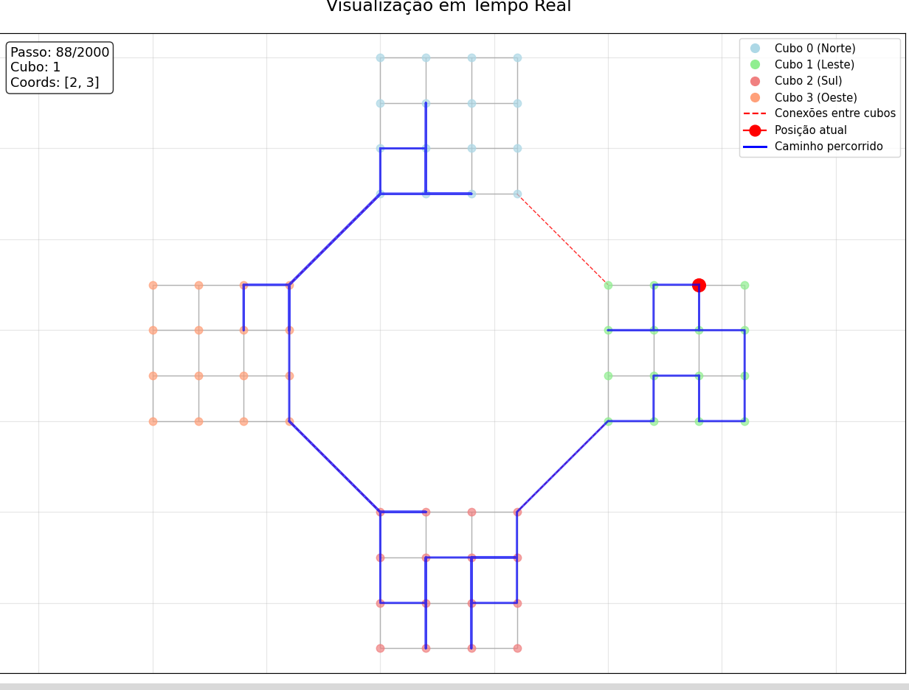
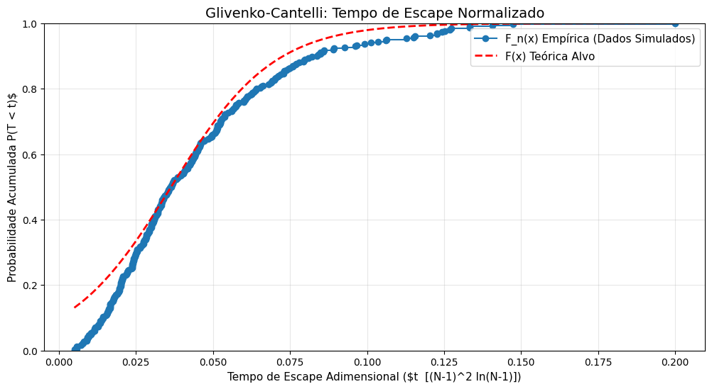

# Simulações Computacionais de Metaestabilidade

Repositório contendo as implementações em Python desenvolvidas para o Trabalho de Conclusão de Curso (TCC) **Metaestabilidade**, apresentado ao Instituto de Matemática da Universidade Federal da Bahia (UFBA).

---

## 1. Introdução do TCC

A **metaestabilidade** é um fenômeno característico de sistemas dinâmicos e estocásticos nos quais um processo permanece aprisionado por longos períodos em regiões de aparente equilíbrio (os chamados *vales* ou *estados metaestáveis*), antes de realizar uma transição abrupta e rara para outra configuração estável. Esse comportamento aparece tanto na Física Estatística (como no congelamento súbito de líquidos em sobrefusão ou na inversão de campos magnéticos) quanto na teoria das Cadeias de Markov e em algoritmos estocásticos.

Na monografia, o fenômeno é investigado sob duas perspectivas teóricas complementares:

* **Passeios aleatórios no hipercubo $H_N = \{-1, +1\}^N$:** demonstrou-se que o tempo assintótico necessário para o acoplamento (*coupling*) de dois passeios homogêneos preguiçosos partindo de configurações opostas escala com $N \log N$ (Teorema 2.1), enquanto no passeio não preguiçoso o primeiro retorno a uma configuração já visitada ocorre assintoticamente apenas por meio de um passo imediato de ida e volta na mesma coordenada (Teorema 2.2).
* **Abordagem potencial e *model reduction*:** utilizando malhas $d$-dimensionais interligadas apenas por vértices de canto (criando gargalos estruturais), formaliza-se a metaestabilidade por meio da técnica de *última passagem* e de mudanças de escala temporal $\alpha_N$ (de ordem $N^2 \log N$ em $d = 2$ e $N^d$ em $d \ge 3$), permitindo reduzir a dinâmica microscópica a uma cadeia de Markov macroscópica entre os vales na topologia de Skorohod.

Nesse contexto, as **simulações em Python** presentes neste repositório cumprem o papel de apoio visual e experimental às demonstrações analíticas. Por meio de animações em tempo real e experimentos de Monte Carlo, os scripts permitem observar a propagação do acoplamento entre configurações de spins, visualizar a retenção prolongada de partículas em regiões densamente conectadas de um grafo e verificar empiricamente as escalas teóricas dos tempos de encontro e de escape.

---

## 2. Visão Geral das Simulações

Os scripts correspondem aos experimentos da **Seção 3.3** da monografia e dividem-se em três frentes de modelagem:

### 2.1. Caminhar Aleatório com Acoplamento no Hipercubo (Seção 3.3.1)

Implementa duas cadeias no hipercubo $\{-1, +1\}^{\text{TAM}}$ iniciadas em configurações opostas (`+1` e `-1`), que passam a evoluir de forma sincronizada nas coordenadas em que já coincidiram.

* **`walkUmDimConsole.py`** *(execução em terminal)*:
  * **O que faz:** Executa múltiplas rodadas independentes do processo de acoplamento até que todas as coordenadas coincidam, calculando ao final a média empírica e o desvio padrão do número de passos necessários.
  * **Parâmetros principais:** Solicitados interativamente via terminal — `qtd` (número de simulações) e `TAM` (dimensão $N$ da cadeia de spins).
  * **Resultado teórico evidenciado:** Confirma experimentalmente a escala assintótica $\mathbb{E}(t_N^-) \sim N \log N$ estabelecida no **Teorema 2.1**.
* **Versão animada (Figura 3.2 do TCC):**
  * **O que faz:** Utiliza `FuncAnimation` (`matplotlib`) para ilustrar passo a passo os spins positivos (vermelho), negativos (preto) e as coordenadas já acopladas (verde) para `TAM = 50`.
  * **Resultado teórico evidenciado:** Ilustra visualmente a propagação irreversível das coordenadas acopladas e o tempo total de encontro comparado à estimativa $N \log N$.

### 2.2. Metaestabilidade em Malhas Conectadas — 4 Estados (Seção 3.3.2)

Constrói um grafo composto por quatro malhas quadradas $d$-dimensionais ($E_0, E_1, E_2, E_3$), cada uma com $N^d$ vértices, conectadas entre si exclusivamente por pares de vértices de canto.

* **`walkDuasDimConsole.py`** *(execução em terminal)*:
  * **O que faz:** Simula um passeio aleatório uniforme sobre o grafo a partir do interior do Cubo 0 e contabiliza o tempo total de permanência em cada cubo e a matriz de transições entre os quatro estados.
  * **Parâmetros principais:** `N = 10` (lado da malha), `d = 2` (dimensão) e `iter = 1000` (número de passos).
  * **Resultado teórico evidenciado:** Demonstra numericamente a disparidade entre o tempo de residência dentro de cada vale (alta conectividade interna) e a raridade das transições pelos gargalos de canto, fundamentando a redução de modelo (*coarse-grained model*) da **Seção 3.2**.
* **`walkDuasDimGraph.py`** *(visualização animada — Figura 3.3 do TCC)*:
  * **O que faz:** Projeta os quatro cubos nas direções Norte (0), Leste (1), Sul (2) e Oeste (3), destacando as conexões entre cubos em vermelho tracejado e animando a trajetória da partícula em tempo real.
  * **Parâmetros principais:** `N = 4` (grade $4 \times 4$ por cubo), `d = 2`, `iter = 2000` passos e `interval = 150` ms entre quadros.
  * **Resultado teórico evidenciado:** Evidencia visualmente a termalização local dentro de um vale antes que a partícula encontre o vértice de saída para um estado vizinho.



### 2.3. Convergência da Distribuição do Tempo de Saída (Seção 3.3.3)

Modela o tempo necessário para que uma partícula iniciada no centro de uma malha bidimensional atinja sua fronteira.

* **`TempoEscape.py`**:
  * **O que faz:** Gera uma grade $2\text{D}$ via `networkx.grid_2d_graph`, executa sucessivas caminhadas partindo do centro `(mid, mid)` até tocar a borda e normaliza cada tempo de saída pelo fator $\alpha_N = (N-1)^2 \ln(N-1)$, plotando a distribuição acumulada empírica dos tempos de escape.
  * **Parâmetros principais:** `N = 1000` (tamanho da malha interna) e `tentativas = 100` (amostras de escape). *(Na versão apresentada na Figura 3.4 do TCC, utiliza-se também `scipy.stats.logistic` para comparar a curva empírica $\hat{F}_n(x)$ com a distribuição teórica alvo pelo Teorema de Glivenko-Cantelli).*
  * **Resultado teórico evidenciado:** Valida a ordem de grandeza do tempo de escape $\alpha_N = N^2 \log N$ em dimensão $d = 2$ discutida na **Seção 3.1** (e fundamentada pelo **Teorema 1.3**).

---

## 3. Como Baixar no Windows e no Linux

Você pode obter os arquivos do repositório utilizando o **Git** (recomendado) ou baixando o pacote **`.zip`** diretamente pelo navegador.

### Opção A Clonando via Git (Windows e Linux)

1. Abra o terminal:
   * **Windows:** Abra o *Prompt de Comando (CMD)*, *PowerShell* ou *Git Bash*.
   * **Linux:** Abra o seu emulador de terminal (`Ctrl + Alt + T`).
2. Navegue até a pasta onde deseja salvar o projeto e execute:

```bash
git clone https://github.com/JoaoDelgado12/Metaestabilidade-Potencial
cd Metaestabilidade-Potencial
```

### Opção B: Baixando o arquivo .zip pelo GitHub (Windows e Linux)
1. Na página principal deste repositório no GitHub, clique no botão verde <> Code.
2. Selecione a opção Download ZIP.
3. Extraia o arquivo baixado:
    - Windows: Clique com o botão direito sobre o arquivo .zip $\rightarrow$ Extrair Tudo... e abra a pasta extraída.
    - Linux: Execute no terminal:
    ```
    unzip Metaestabilidade-Potencial-main.zip
    cd Metaestabilidade-Potencial-main
    ```

## 4. Como Configurar o Ambiente e Rodar as Simulações
4.1. Pré-requisitos
- Python 3.8 ou superior instalado no sistema.
- Bibliotecas necessárias:
  - numpy
  - matplotlib
  - networkx
  - scipy (opcional, caso utilize a plotagem da CDF teórica da Seção 3.3.3)

4.2. Criação do Ambiente Virtual e Instalação das Dependências
Abra o terminal dentro da pasta raiz do projeto e siga as instruções correspondentes ao seu sistema operacional:

### No Windows (PowerShell ou CMD)
```
# 1. Criar o ambiente virtual
python -m venv venv

# 2. Ativar o ambiente virtual (PowerShell)
.\venv\Scripts\Activate.ps1
# (Se estiver usando o CMD tradicional, utilize: venv\Scripts\activate.bat)

# 3. Atualizar o pip e instalar as bibliotecas
python -m pip install --upgrade pip
pip install numpy matplotlib networkx scipy
```

Nota para Windows (PowerShell): Caso ocorra erro de permissão de execução de scripts ao ativar o venv, execute Set-ExecutionPolicy -ExecutionPolicy RemoteSigned -Scope CurrentUser e tente ativar novamente.

### No Linux (Ubuntu/Debian/Fedora/Arch) 

```
# 1. Criar o ambiente virtual (caso necessário, instale o pacote python3-venv da sua distro)
python3 -m venv venv

# 2. Ativar o ambiente virtual
source venv/bin/activate

# 3. Atualizar o pip e instalar as bibliotecas
pip install --upgrade pip
pip install numpy matplotlib networkx scipy
```
Nota para Linux: Para que as janelas gráficas e animações do matplotlib abram corretamente, certifique-se de ter o backend Tkinter instalado no sistema (ex.: sudo apt install python3-tk no Ubuntu/Debian).

4.3. Executando Cada Simulação
Com o ambiente virtual (venv) ativado, execute os comandos abaixo:

1. Acoplamento no Hipercubo (Console)
- Windows:
```
python walkUmDimConsole.py
```
- Linux:
```
python walkUmDimConsole.py
```
Informe a quantidade de simulações (ex.: 100) e o tamanho da cadeia (ex.: 50) quando solicitado no terminal.

2. Metaestabilidade em 4 Cubos (Métricas no Console)
- Windows:
```
python walkDuasDimConsole.py
```
- Linux:
```
python walkDuasDimConsole.py
```
3. Metaestabilidade em 4 Cubos (Animação Gráfica)
- Windows:
```
python walkDuasDimGraph.py
```
- Linux:
```
python walkDuasDimGraph.py
```
4. Distribuição do Tempo de Escape em Malha 2D
- Windows:
```
python TempoEscape.py
```
- Linux:
```
python TempoEscape.py
```
Dica de desempenho: O script TempoEscape.py está configurado por padrão com N = 1000 e tentativas = 100, o que exige alto processamento e pode levar alguns minutos. Para uma execução rápida de teste, altere N = 100 e tentativas = 100 no final do arquivo.   
Referências Bibliográficas do Trabalho
- KERN, J. The Skorohod Topologies: What They Are and Why We Should Care. Preprint, arXiv:2210.16026 [math.PR], 2023.
- LANDIM, C. Metastable Markov chains. Probability Surveys, v. 16, p. 143–227, 2019.
- LEVIN, D. A.; PERES, Y. Markov Chains and Mixing Times. 2. ed. Providence, RI: American Mathematical Society, 2017.
- SIMONIS, A.; PEIXOTO, C. M. Tópicos em Processos Estocásticos: Eventos Raros, Tempos Exponenciais e Metaestabilidade. 25º Colóquio Brasileiro de Matemática. Rio de Janeiro: IMPA, 2005.

